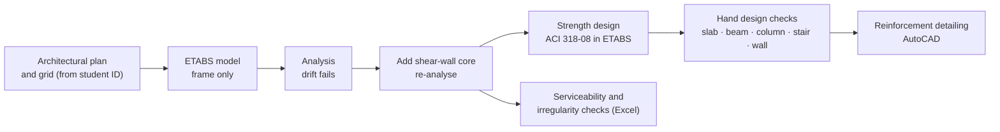

# 8-Storey RC Residential Building — ETABS Analysis & Design (BNBC 2020)


Structural analysis and design of a **G+7 reinforced concrete residential building in Dhaka**, following the **Bangladesh National Building Code (BNBC) 2020**. The work covers modelling and analysis in ETABS, a comparison of the layout with and without a shear wall, serviceability and irregularity checks in Excel, hand design of key members, and reinforcement detailing in AutoCAD.

> **Course:** CEE 4712 — Structural Analysis & Design Sessional II, Assignment 02
> Department of Civil and Environmental Engineering, Islamic University of Technology (IUT)
> **Submitted to:** Md. Aktaruzzaman Rony, Junior Lecturer, CEE
> **Submitted by:** Farhan Muhammad Rafi Kamal (ID 210051162), March 2026

---

## Contents

- [Building at a glance](#building-at-a-glance)
- [Workflow](#workflow)
- [Loads](#loads)
- [Modelling assumptions](#modelling-assumptions)
- [Key results](#key-results)
- [Hand design summary](#hand-design-summary)
- [Repository structure](#repository-structure)
- [How to open the files](#how-to-open-the-files)
- [Codes and references](#codes-and-references)

## Building at a glance

| Item | Value |
|---|---|
| Use | Residential, two flats per floor, central stair and lift core |
| Location | Dhaka, Bangladesh (Seismic Zone 2, Z = 0.20) |
| Storeys | G+7 — ground floor 7 ft, typical floors 10 ft, total height 87 ft (≈ 26.5 m) |
| Plan size | 62 ft × 47 ft |
| Grid spacing, X (A–G) | 7, 20, 4, 5, 14, 12 ft |
| Grid spacing, Y (1–4) | 14, 19, 14 ft |
| Lateral system | Dual system: special moment-resisting frame (SMRF) + special RC shear walls |
| Concrete / rebar | f′c = 4,000 psi; f<sub>y</sub> = 60,000 psi (Grade 60) |
| Columns | 20 × 20, 22 × 22 and 24 × 24 in |
| Beams | Floor beams 12 × 24 in; grade beams 14 × 26 in |
| Slabs | 6 in two-way slab; 8 in landing; 10 in stair waist slab |
| Shear walls | 10 in RC walls at the lift core |

The grid spacings come from the student ID (X = last digit = 2; Y = sum of the last two digits = 8), as the assignment specifies.

## Workflow



## Loads

**Gravity**

| Load | Value |
|---|---|
| Self-weight | Calculated by ETABS (concrete 150 pcf) |
| Floor finish | 25 psf |
| Exterior wall (10 in brick) | 1.0 kip/ft |
| Interior partition (5 in brick) | 0.5 kip/ft |
| Parapet | 0.15 kip/ft |
| Live load, residential floors | 2.0 kN/m² (≈ 42 psf) |
| Live load, stairs and exits | 4.8 kN/m² (≈ 100 psf) |

**Lateral**

| Parameter | Value |
|---|---|
| Basic wind speed | 147 mph (65.7 m/s); I = 1.0, K<sub>d</sub> = 0.85, G = 0.85, K<sub>zt</sub> = 1.0 |
| Seismic zone coefficient | Z = 0.20 (Dhaka, Zone 2) |
| Site class / SDC | SE / D |
| R, Ω<sub>0</sub>, C<sub>d</sub>, I | 8, 3, 5.5, 1.0 |
| Period used | T = 0.89 s |
| F<sub>a</sub>, F<sub>v</sub> | 1.4, 1.75 |

The models use **17 load combinations** from BNBC 2020. They include 1.4D, 1.2D + 1.6L + 0.5L<sub>r</sub>, wind combinations (±0.8W, ±1.6W), seismic combinations 1.246D ± E + L and 0.854D ± E, and service combinations (D + L, D + 0.5L ± 0.7W).

## Modelling assumptions

- ETABS 20.3. Slabs and walls are thin shells, auto-meshed at 48 in maximum.
- Rigid floor diaphragm at each level. Fixed supports at the base.
- Mass source: dead load + superimposed dead load + 0.25 × live load.
- Two copies of the final (shear-wall) model, differing only in cracked-section stiffness modifiers:

| Model | Columns | Beams | Shear walls | Used for |
|---|---|---|---|---|
| `strength_check` | 0.70 I<sub>g</sub> | 0.35 I<sub>g</sub> | 0.70 | Member design (ultimate loads) |
| `serviceability_check` | 0.98 I<sub>g</sub> | 0.49 I<sub>g</sub> | 0.70 | Drift and deflection (service loads; 1.4 × the strength values) |

## Key results

**Dynamic properties** (final model)

| Mode | Period (s) | Dominant response | Mass participation |
|---|---|---|---|
| 1 | 0.883 | Translation in X | 64 % (UX) |
| 2 | 0.737 | Translation in Y | 52 % (UY) |
| 3 | 0.488 | Torsion | 49 % (RZ) |

**Serviceability and irregularity checks: without vs with shear wall**

| Check | Without shear wall | With shear wall |
|---|---|---|
| Storey drift check | ❌ Fails | ✅ Passes |
| Max design storey drift under EQ (limit 2.4 in = 0.020 h) | 2.24 in | 0.45 in |
| Overall sway | ✅ Passes | ✅ Passes |
| Torsional irregularity, max Δ<sub>max</sub>/Δ<sub>avg</sub> | 1.67 | 1.21 |
| Soft storey (stiffness) | None: stiffness increases toward the base | None |
| Re-entrant corner (a/L = 0.11, b/W = 0.30) | Not irregular: only one projection exceeds 15 % | Same |
| Dual system: frames resist ≥ 25 % of base shear | — | ✅ Yes, in X and Y |

Adding the shear-wall core cut the maximum earthquake drift by about 80 % and brought the drift and torsion behaviour within BNBC 2020 limits. The full calculations are in the Excel workbook.

## Hand design summary

| Member | Design |
|---|---|
| **Slab** (9 ft × 9.5 ft panel, two-way) | 6 in thick; #3 @ 10 in c/c both ways; T&S #3 @ 10 in |
| **Beam** (12 × 24 in, 19 ft span) | Top 3 #8 at support; bottom 2 #8 at midspan; #3 stirrups @ 6 in (ends) / 8 in (middle) |
| **Column** (24 × 24 in) | 8 #10 bars (ρ = 1.76 %); #4 ties @ 5 in (ends) / 10 in (middle) |
| **Stair** (two-flight) | 10 in waist slab, #4 @ 10 in main, #3 @ 8 in distribution; 8 in landing, #3 @ 7 in both ways |
| **Shear wall** (9 ft × 10 in; V<sub>u</sub> = 275 kip, M<sub>u</sub> = 21,000 kip-ft) | Horizontal #4 @ 6 in; vertical #5 @ 8 in; 1.5 ft boundary elements with 6 #8 and #3 ties @ 4 in |

The hand results are checked against the ETABS ACI 318-08 design output, which is included in the report. AutoCAD drawings cover the beam and grade-beam long sections, the column schedule and the slab reinforcement layout.

## Repository structure

```
rc-8storey-building-etabs-bnbc2020/
├── README.md
├── .gitignore
├── models/
│   ├── 210051162_strength_check.EDB          # ETABS model (cracked sections for strength)
│   ├── 210051162_strength_check.e2k          # same model as a text file
│   ├── 210051162_serviceability_check.EDB    # ETABS model (service-level stiffness)
│   └── 210051162_serviceability_check.e2k
├── calculations/
│   └── 210051162_serviceability_checks.xlsx  # drift, sway, torsion, soft storey, re-entrant, base shear
└── reports/
    ├── 210051162_design_report.pdf           # loads, hand design, AutoCAD detailing, references, appendix
    └── 210051162_ETABS_report.pdf            # ETABS-generated report (372 pages)
```

## How to open the files

- **`.EDB`:** open in **ETABS 20.3 or later**. Analysis results are not stored in the repository, so press **Run Analysis (F5)** to regenerate them.
- **`.e2k`:** a plain-text version of the same model. Use it with other ETABS versions (**File → Import → ETABS .e2k Text File**), or read it to see the model inputs without ETABS.
- **`.xlsx`:** open in Excel. The input columns are values exported from ETABS tables (story drifts, max/avg displacements, story stiffness, base reactions).

## Codes and references

- **BNBC 2020**, Bangladesh National Building Code: loads, seismic and wind design, load combinations, drift limits and irregularities.
- **ACI 318-08**, Building Code Requirements for Structural Concrete: member design in ETABS and in the hand checks.
- **ETABS 20.3** (Computers and Structures, Inc.): analysis and design.

The report lists the BNBC 2020 page references for each provision used.

## Note on use

This repository is shared as a record of completed coursework. Students taking CEE 4712 or a similar course should do their own work and not submit any part of this project as their own.

---

**Author:** Farhan Muhammad Rafi Kamal, B.Sc. in Civil and Environmental Engineering, IUT
